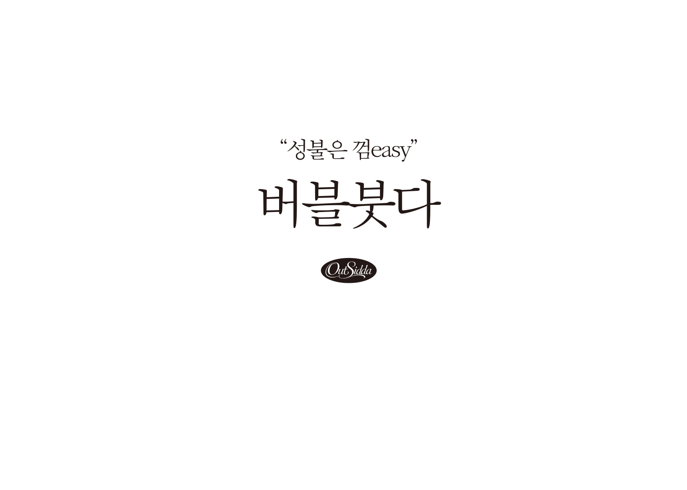
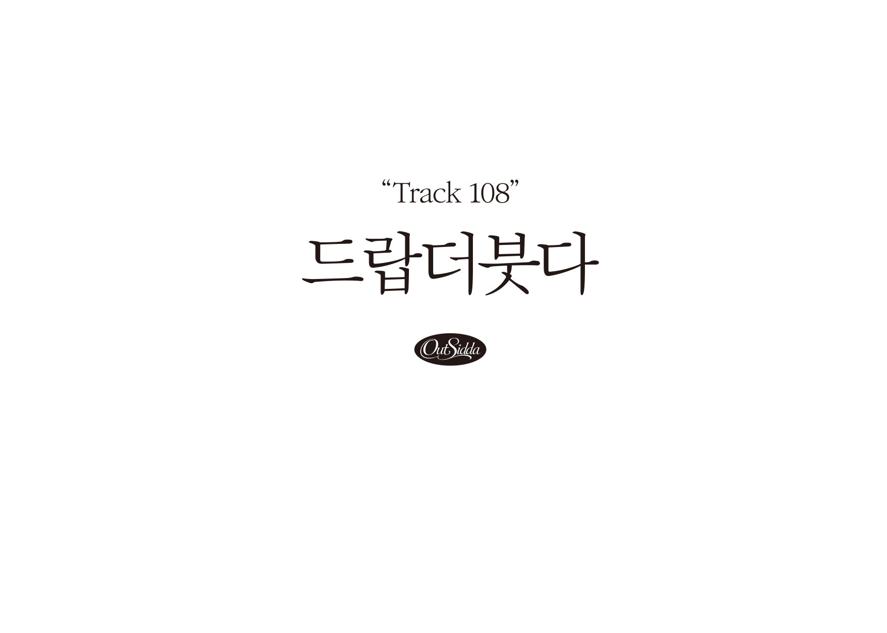
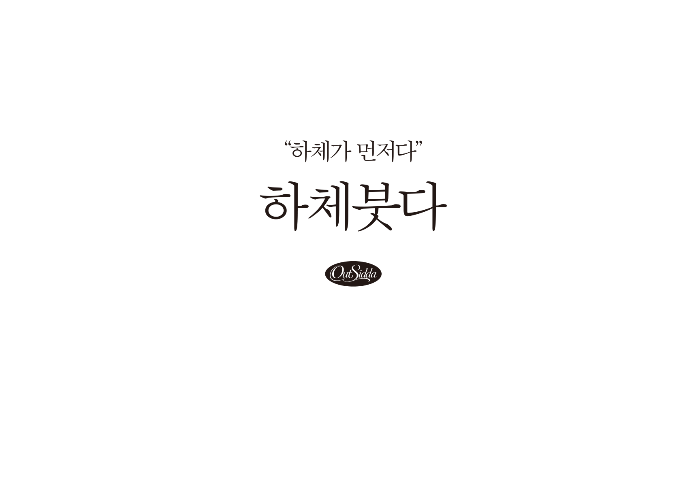
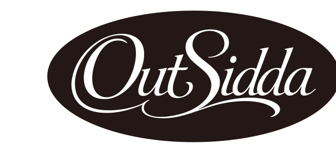

# 붓쯔 (BUDDHZ) 브랜드 디자인 레퍼런스

사용자가 "꼭 기억해"라고 지정한 기준 디자인입니다. 이 브랜드와 관련된 굿즈, 웹, 이미지 작업은 모두 이 문서와 `source/` 원본을 따릅니다.

원본 위치: `design/brand/source/*.ai` (PDF 호환 Illustrator 파일)
미리보기: `design/brand/preview/*.png`
PDF 가이드: `design/brand/BUDDHZ-brand-guide.pdf` (원본 HTML: `guide-src/guide.html`)

---

## 1. 메인 로고: 붓쯔 / BUDDHZ


- 파일: `source/buddhz-logo-green.ai` (원제 `_붓쯔 로고(초록)`, 1080×1080pt 정사각형)
- 구성: 상단에 한글 워드마크 **붓쯔**, 하단에 영문 **BUDDHZ**가 같은 폭으로 놓인 2단 락업
- 한글 "붓쯔"는 직선 획으로 만든 커스텀 레터링입니다. 기본 폰트로 대체하지 마세요. 로고는 반드시 원본 벡터를 사용합니다.
- 영문 "BUDDHZ"는 기하학적 산세리프체입니다(라운드 형태, 일정한 획 두께).
- 컬러: **붓쯔 그린 `#1C9771`** (RGB 28·151·113), 단색 사용
- 배경: 흰색, 여백을 넉넉하게

## 2. 티셔츠 뒷면 시리즈: "○○붓다"

세 디자인은 같은 템플릿을 공유합니다. 문구만 바꿔 넣는 시리즈입니다.

| 디자인 | 상단 인용구 | 메인 타이틀 | 파일 |
|---|---|---|---|
| 버블붓다 | “성불은 껌easy” | 버블붓다 | `source/tshirt-back-bubble-buddha.ai` |
| 드랍더붓다 | “Track 108” | 드랍더붓다 | `source/tshirt-back-drop-the-buddha.ai` |
| 하체붓다 | “하체가 먼저다” | 하체붓다 | `source/tshirt-back-hache-buddha.ai` |





### 템플릿 규칙
- 아트보드: 858.9 × 612.3pt (가로형), 모든 요소는 **가로 중앙 정렬**, 아트보드 위쪽 절반 안에 배치
- 위에서부터 차례로:
  1. **인용구**: 큰따옴표(“ ”)로 감싼 짧은 말장난 문구, 약 30pt
  2. **메인 타이틀**: "○○붓다", 약 69pt (인용구의 약 2.3배)
  3. **OutSidda 배지**: 타원형 검정 배지 안에 흰색 스크립트체 "OutSidda", 폭 약 80pt
- 서체: **SD명조 (SDMyeongjo-aLt, 산돌)**. 인용구와 타이틀 모두 같은 명조체를 사용합니다. 버블붓다 원본은 라이브 텍스트이고, 드랍더붓다와 하체붓다는 아웃라인 처리되어 있습니다.
- 컬러: 리치블랙 **`#231916`** (RGB 35·25·22) 단색, 바탕은 흰색
- 톤: 불교/붓다 키워드에 밈·유행어·운동 같은 현대 말장난을 섞은 위트 있는 문구 (예: 성불 + 껌이지, 108번뇌 + Track 108, 하체 운동)

## 3. OutSidda 배지



- 가로로 긴 타원, 배경 `#231916`, 흰색 캘리그래피 스크립트 "OutSidda"(O와 S 대문자에 스워시)
- 티셔츠 시리즈 하단의 서명/브랜드 마크로 사용합니다. 시리즈 원본에서 벡터를 가져다 쓰세요.

## 컬러 토큰

```css
:root {
  --buddhz-green: #1C9771; /* 메인 로고 */
  --ink: #231916;          /* 티셔츠 시리즈, OutSidda 배지 */
  --paper: #FFFFFF;
}
```
